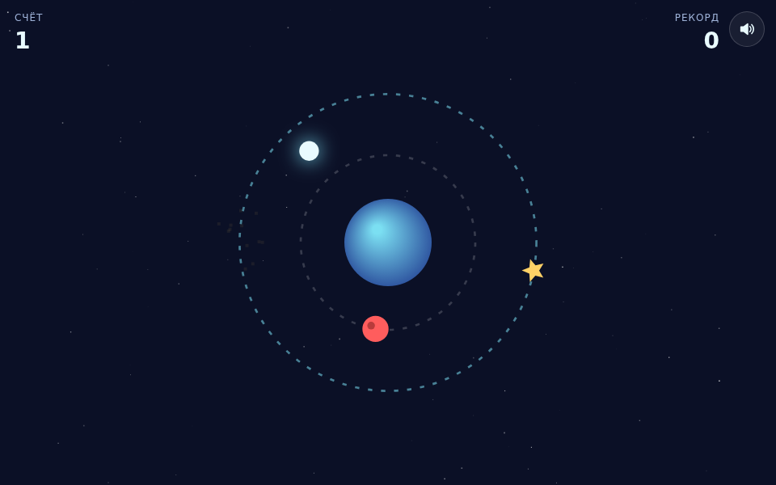

# Орбита: HTML5-игра с интеграцией Yandex Games SDK

Казуальная игра на canvas и готовый шаблон для публикации на Яндекс Играх: реклама, облачные сохранения, лидерборд, язык площадки и пауза уже подключены. Локально всё работает без SDK через заглушку.



## Возможности

**Игра**
- Игрок летит по орбите вокруг планеты, нажатие переключает внутреннюю и внешнюю орбиту
- Звёзды дают очки, метеориты заканчивают партию
- Метеорит сначала мигает и безопасен 0,7 секунды, поэтому смерть всегда честная
- Скорость и частота объектов растут со счётом и упираются в потолок
- Плавный переход между орбитами, частицы, тряска экрана при столкновении
- Звуки синтезируются через Web Audio, файлов нет, кнопка выключения звука запоминается

**Интеграция с Яндекс Играми**
- `LoadingAPI.ready()` после загрузки и `GameplayAPI.start()/stop()` по ходу партии (нужно для модерации)
- Полноэкранная реклама между партиями: не чаще раза в 60 секунд и только каждую вторую партию
- Реклама за вознаграждение: продолжить партию один раз после проигрыша
- Во время рекламы игра на паузе, звук выключен
- Прогресс в облаке игрока плюс копия в `localStorage`, при расхождении берётся лучшее
- Рекорд отправляется в лидерборд
- Язык из `environment.i18n.lang`: русский, английский, турецкий
- Пауза при сворачивании вкладки и по событиям площадки `game_api_pause` / `game_api_resume`

**Под телефон**
- Canvas масштабируется под экран и плотность пикселей (до 2x)
- Отключены зум, выделение текста, контекстное меню и прокрутка страницы
- Учитываются вырезы экрана (`safe-area-inset`)

## Стек

JavaScript без сборщика и фреймворков, Canvas 2D, Web Audio API, Yandex Games SDK v2, `node:test` для тестов логики.

## Как запустить

Сборка не нужна: откройте `index.html` в браузере. Можно через локальный сервер:

```bash
python -m http.server 8000
# открыть http://localhost:8000
```

Тесты логики (Node.js 18+):

```bash
npm test
```

## Управление

| Действие | Клавиатура | Телефон |
|---|---|---|
| Начать, переключить орбиту | Пробел, Enter, стрелки вверх и вниз | Нажатие по экрану |
| Пауза | P или Esc | Сворачивание вкладки |
| Ещё раз после проигрыша | Пробел или Enter | Кнопка «Ещё раз» |

## Публикация на Яндекс Играх

1. Соберите архив с игрой: `npm run zip` (или вручную заархивируйте `index.html`, `css`, `js`). В корне архива должен лежать `index.html`.
2. В консоли разработчика Яндекс Игр создайте черновик и загрузите архив.
3. Создайте лидерборд с техническим именем `orbitScore` или поменяйте имя в `js/game.js`.
4. Загрузите иконку, обложку и скриншоты, заполните описание на нужных языках.
5. Отправьте на модерацию.

SDK подключается сам: на домене Яндекс Игр скрипт `ya.js` загружает `/sdk.js`. Чтобы проверить загрузку SDK на своём сервере, добавьте к адресу `?sdk=1`.

## Настройка

- Частота полноэкранной рекламы: `new L.AdPolicy({ cooldown: 60, everyGames: 2 })` в `js/game.js`
- Скорость, интервал появления и доля метеоритов: функции `speedFor`, `spawnInterval`, `spawn` в `js/logic.js`
- Тексты и языки: `js/i18n.js`
- Цвета: переменные в начале `css/style.css` и цвета в `draw()` в `js/game.js`

## Структура проекта

```
index.html          # разметка интерфейса поверх canvas
css/style.css       # HUD, панели меню, заглушка рекламы
js/logic.js         # чистая логика без DOM: столкновения, сложность, политика рекламы
js/i18n.js          # тексты на русском, английском и турецком
js/ya.js            # обёртка над Yandex Games SDK с локальной заглушкой
js/game.js          # игровой цикл, отрисовка, ввод, звук
tests/logic.test.js # тесты логики на node:test
```

## Как это устроено

- Игра обращается только к объекту `YA`. Он сам решает, работать с настоящим SDK или с заглушкой, поэтому тот же код запускается и локально, и на площадке.
- Игровой цикл на `requestAnimationFrame` с фиксированным шагом симуляции 1/120 секунды: скорость не зависит от частоты экрана, а после сворачивания вкладки нет скачков.
- Логика вынесена в `logic.js` без обращений к DOM, поэтому её можно тестировать в Node.
- Для случайных чисел используется mulberry32 с сидом: партию можно воспроизвести для отладки.
- Политика рекламы считает партии и время с последнего показа: игрок не видит рекламу после каждой смерти.
- Награда за рекламу выдаётся только после `onRewarded`, а не по закрытию окна.

## Идеи для развития

- Магазин скинов за собранные звёзды
- Ежедневные задания и награды
- Бонусы: щит, замедление времени, магнит для звёзд
- Перенос шаблона SDK в Unity WebGL через jslib-мост

## Лицензия

MIT © 2026 whysafe. Telegram: [@yawhysafe](https://t.me/yawhysafe) · Сайт: [whysafe.ru](https://whysafe.ru)
